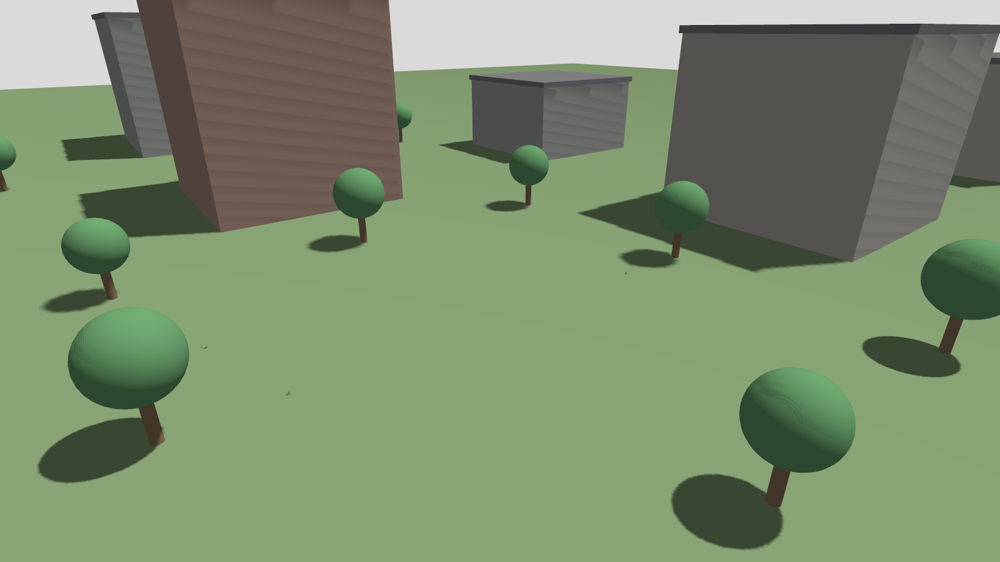
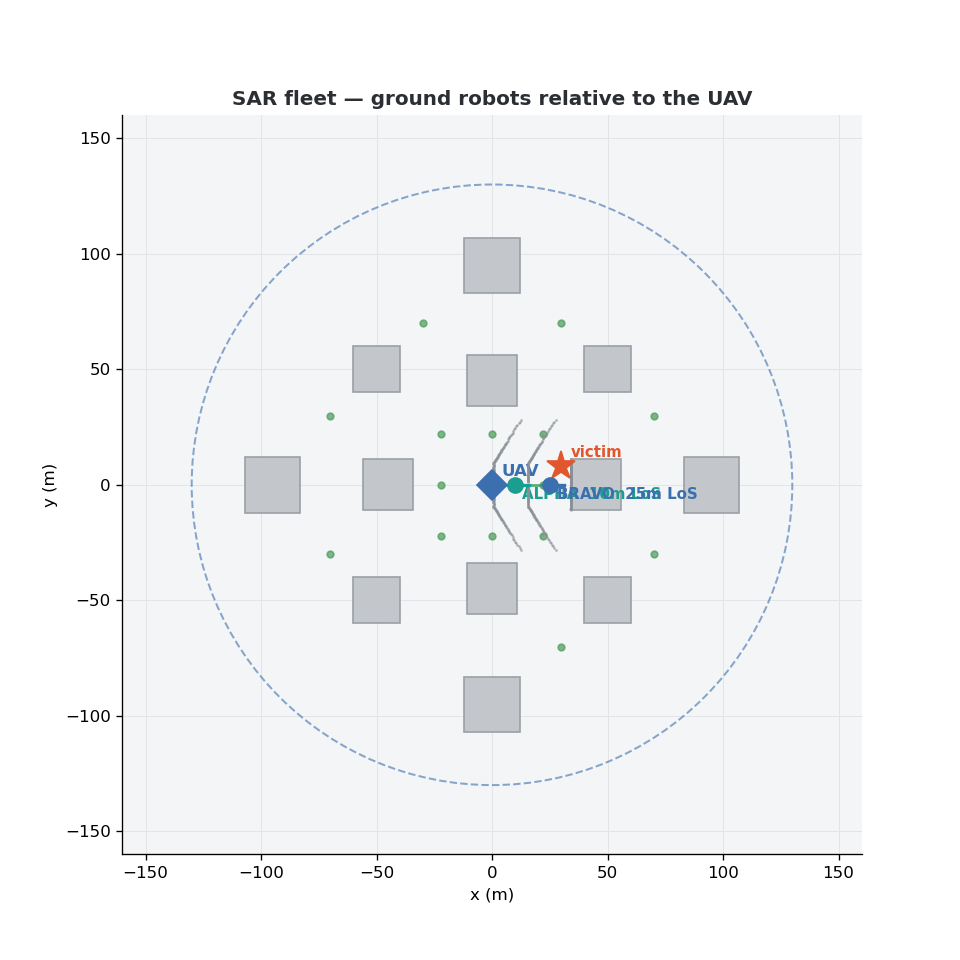

# 5G Nomadic Nodes for Multi-Robot Search & Rescue

MSc research testbed for **AI-assisted 5G nomadic nodes** — UAV-mounted base stations
providing on-demand 5G NR connectivity to ground robots in search-and-rescue (SAR)
scenarios. This repo hosts the OAI 5G SA stack, the Gazebo-to-OAI channel bridge that
ties simulated UAV/UGV mobility to real PHY-layer link conditions, and the soak-test
logs used to validate stability.

> MSc candidate: Electrical Engineering (Telecommunications), University of Cape Town
> Supervisor: Dr. Joyce Mwangama
> Funding: Telkom-NRF FutureTech Programme, DIGITAfrica (Horizon Europe)



<sub>The urban NLoS world in **Gazebo Harmonic**: the building facades are the
line-of-sight blockers for the air-to-ground 5G link, with the UAV base station holding
overhead and the two TurtleBot3 ground robots patrolling between the blocks. Drive a
robot behind a building and its uplink degrades as the channel bridge applies the NLoS
path loss.</sub>



<sub>The live situational map from the same scenario: the UAV-mounted base station (blue
diamond), the two ground-robot UEs (ALPHA/BRAVO), a detected victim heat source, building
footprints, the coverage radius, and the current line-of-sight state — all driven by real
Gazebo poses feeding the OAI channel bridge.</sub>

---

## What this is

The core research question is about **AI-assisted nomadic 5G communication networks**
— search-and-rescue is the application context, not the contribution itself. The
testbed here validates that a UAV-mounted 5G base station can maintain a stable link
to ground robot UEs while the UAV's position (and therefore the air-to-ground channel)
changes dynamically.

Concretely, this repo implements:

1. A working **OpenAirInterface (OAI) 5G SA stack** (gNB + 2× UE) running over the
   `rfsimulator`, Band n78, 106 PRB, backed by an Open5GS core.
2. A **Gazebo → OAI channel bridge** (`channel_bridge.py`) that subscribes to robot
   pose topics in Gazebo, computes air-to-ground (A2G) path loss from that pose, and
   pushes live `channelmod modify` commands to OAI over telnet — so link quality in
   the RF simulator reflects actual simulated robot movement.
3. A **soak-test harness** (`soak_test.sh`) that runs the full stack under load
   (ping + iperf3 in both directions) for extended periods and logs RF/PHY and
   application-layer metrics for stability validation.

## Current status

**See [`docs/SYSTEM_ARCHITECTURE.md`](docs/SYSTEM_ARCHITECTURE.md) for the full,
current system description** — components, traffic paths, metrics dictionary,
verification playbook, and operational limits.

As of 2026-07-09 the full stack is one command (`./start_full_stack.sh`) and the
whole loop is closed and verified against the gNB's own MAC counters:

- **Real robot models** — PX4 x500 UAV (static hold at 40 m) + 2× TurtleBot3
  burger, spawned into `sar_open_field` with the names the bridge expects.
- **Continuous channel coupling** — robot distance maps monotonically to path
  loss over the whole 10–190 m range (10 m→~13 dB … 190 m→~42 dB alpha UL),
  including sub-baseline values inside the 50 m reference (dead-zone fixed).
- **Honest traffic in both directions** — per-robot network namespaces force
  uplink *and* downlink over the air. Uplink ~20–24 Mbps TCP close range,
  degrading to link loss at ~160 m (recovers on return); C2/e-stop downlink
  probes run 30–70 ms RTT and visibly degrade when the uplink saturates.
- **ML data collection** — `scripts/auto_patrol.py --free` roams both robots
  continuously and logs geometry + channel + TCP/UDP-video/ping/C2 + modem
  metrics per sample.

Earlier milestone: the 45-minute soak test (`logs/soak_20260702_005642/`)
validated link stability (0 RNTI churn, 22/22 iperf bursts, 0% ping loss)
after switching the channel models to **AWGN** — Rayleigh1's slow-fade dwell
had been causing RLF instability.

---

## Repository structure

```
sar_sim/
├── start_full_stack.sh        # ONE-COMMAND bring-up: core -> RAN -> Gazebo -> models
│                              #   -> bridge -> viz -> robot netns (every step gated)
├── channel_bridge.py          # Gazebo pose -> A2G path loss -> channelmod modify (telnet)
├── restart_ran.sh             # Strict-order RAN restart after RLF (gNB -> alpha -> bravo)
├── soak_test.sh               # Runs stack under sustained ping + iperf3 load, logs metrics
├── verify_stack.sh            # Health check: confirms gNB + UE processes are up
│
├── oai_configs/               # Working OAI gNB / UE configs (the "known good" set)
│   ├── gnb.sa.band78.rfsim.conf
│   ├── nrue_alpha.conf
│   ├── nrue_bravo.conf
│   ├── channelmod_sar.conf    # Channel model definitions (AWGN)
│   └── SIMULATION_GUIDE.md
│
├── configs/                    # Historical / alternative config variants
│                                # (srsRAN, UERANSIM, ZMQ-based experiments)
│
├── logs/
│   ├── channel_bridge_log.csv  # Bridge's own path-loss update log
│   ├── sar_metrics_*.csv       # Per-session SAR metrics
│   └── soak_YYYYMMDD_HHMMSS/   # One directory per soak test run:
│       ├── summary.txt         #   Human-readable run summary
│       ├── sinr_samples.csv    #   Per-UE RSRP/SINR time series
│       ├── ping_a2b.csv        #   alpha->bravo ping log (see note below)
│       ├── iperf_bursts.csv    #   Per-burst throughput, both directions
│       ├── rntis_before.txt / rntis_after.txt   # Link-survival check
│       └── gnb_stats.log, bridge_stdout.log     # Raw process logs
│
├── ros_ws/                     # ROS 2 workspace
│   └── src/sar_integration/    # SAR robot integration node (sar_node.py)
│
├── scripts/
│   ├── auto_patrol.py          # ML data collection: moves robots, logs full metrics
│   │                           #   (--free = continuous roam; adds C2 downlink probes)
│   ├── setup_robot_netns.sh    # Per-robot netns: forces DL/C2 traffic over the air
│   ├── setup_over_air_test.sh  # Over-air routing + iperf3 servers
│   ├── gazebo_viz.py           # Beams + metric labels drawn into the Gazebo scene
│   ├── metrics_collector.py    # UE-log parser used by auto_patrol
│   ├── exp1_distance.sh        # Distance-sweep experiment
│   ├── exp2_altitude.sh        # Altitude-sweep experiment
│   ├── exp3_search_pattern.sh  # Search-pattern trajectory experiment
│   ├── parse_gnb_metrics.py    # gNB log -> structured metrics
│   └── set_channel_loss.sh     # Manual channelmod override for testing
│
├── worlds/
│   ├── sar_open_field.sdf      # Current world: 500m open field + reference markers
│   └── x500_static_hold.sdf    # Real x500 geometry, static (UAV holds 40m w/o PX4 SITL)
│
├── docs/
│   ├── SYSTEM_ARCHITECTURE.md  # THE current full-system description (start here)
│   ├── A2G_CHANNEL.md          # Channel model details
│   └── RUN_BRIDGE.md           # Bridge usage in isolation
│
└── OAI_SAR_STACK_REPORT.md     # Standing technical notes on the OAI setup
```

> **Note on `ping_a2b.csv`**: the ping process is a long-running background logger
> and its CSV is **not reset between soak test runs** — a single file can span many
> sessions. Always filter by the run's timestamp window (from `summary.txt`) before
> computing statistics from it; do not treat row count as reply count for a given run.

---

## Requirements

This is a full 5G-SA-over-simulator testbed, not a single package — it stitches
together OAI, a 5G core, ROS 2, and Gazebo. Budget time for the one-time install
of the external stacks; after that the whole thing is one command.

### Hardware

| Resource | Recommended |
|---|---|
| CPU | x86-64, 8+ physical cores (OAI PHY is CPU-heavy) |
| RAM | 16 GB+ |
| Disk | ~40 GB free (OAI + core + models + logs; OAI writes ~5 GB/h of PHY logs) |
| GPU | Not required — Gazebo runs **headless** (`gz sim -s`). A GTX 1650 crashes `gzclient`, so the GUI is optional and separate. |
| Privileges | `sudo`/root — needed for network namespaces, TUN interfaces, and the Open5GS systemd services |

### Software prerequisites (installed once, outside this repo)

| Component | Version | Notes / install pointer |
|---|---|---|
| Ubuntu | 22.04 LTS | Reference platform |
| ROS 2 | Humble | https://docs.ros.org/en/humble/Installation.html |
| Gazebo | Harmonic (`gz-sim` 8.x) | https://gazebosim.org/docs/harmonic/install |
| OpenAirInterface 5G | `develop` (rfsimulator) | Build `nr-softmodem` + `nr-uesoftmodem`. Expected at `$HOME/openairinterface5g`. https://gitlab.eurecom.fr/oai/openairinterface5g |
| Open5GS | 2.8.0 | Installed as systemd services (`open5gs-*`). https://open5gs.org/open5gs/docs/guide/01-quickstart/ |
| MongoDB | 6.0 | Open5GS subscriber DB |
| iperf3 | 3.16 (from source) | Must have `--bind-dev` support — the distro package is too old. https://github.com/esnet/iperf |
| TurtleBot3 sim | Humble | `turtlebot3_simulations` + `turtlebot3_description` — provides the ground-robot (burger) Gazebo models |
| PX4 Gazebo models | — | Provides the x500 UAV model. Any checkout of `PX4-gazebo-models` works. |
| Python | 3.10 | See `requirements.txt` |

Python packages (see [`requirements.txt`](requirements.txt)): `numpy`, `pandas`,
`matplotlib`, `mavsdk`, plus the **`gz-transport` Python bindings** (installed
with Gazebo Harmonic, not via pip).

---

## Installation (from a fresh clone)

The install is in two parts: **A.** install the external stacks (one-time, the
heavy part — budget an afternoon, mostly for the OAI build), then **B.** set up
this repo. All commands target **Ubuntu 22.04**.

### Quick path — one command installs everything

On a fresh Ubuntu 22.04 machine, the whole prerequisite stack (ROS 2, Gazebo,
Open5GS + MongoDB, OpenAirInterface, iperf3, robot models, Python packages) is:

```bash
git clone https://github.com/MgwenaHulela/5g-nomadic-nodes-sar.git
cd 5g-nomadic-nodes-sar
./install_requirements.sh            # installs the entire pipeline (needs sudo)
```

It's re-runnable and you can install one piece at a time, e.g.
`./install_requirements.sh oai` (components: `base ros gz core oai iperf models python`).
When it finishes, skip to **Part B, step B4** to wire up paths and subscribers.

Prefer to do it by hand, or need to adapt a step? The rest of this section is
exactly what the script runs, spelled out.

### Part A — install the external stacks (what the script does)

> Tip: run the prerequisite installs from a scratch directory in `$HOME`. The
> paths below (`$HOME/openairinterface5g`, `$HOME/turtlebot3_ws`, …) are the ones
> `start_full_stack.sh` expects — keep them, or update the script in Part B step 4.

**A1. Base build tools**

```bash
sudo apt update
sudo apt install -y git build-essential cmake curl gnupg lsb-release \
                    software-properties-common python3-pip
```

**A2. ROS 2 Humble + colcon**

```bash
sudo add-apt-repository universe -y
sudo curl -sSL https://raw.githubusercontent.com/ros/rosdistro/master/ros.key \
     -o /usr/share/keyrings/ros-archive-keyring.gpg
echo "deb [arch=$(dpkg --print-architecture) signed-by=/usr/share/keyrings/ros-archive-keyring.gpg] http://packages.ros.org/ros2/ubuntu $(. /etc/os-release && echo $UBUNTU_CODENAME) main" \
     | sudo tee /etc/apt/sources.list.d/ros2.list > /dev/null
sudo apt update
sudo apt install -y ros-humble-desktop ros-dev-tools python3-colcon-common-extensions
echo "source /opt/ros/humble/setup.bash" >> ~/.bashrc
```

**A3. Gazebo Harmonic + the ROS–Gazebo bridge**

```bash
sudo curl https://packages.osrfoundation.org/gazebo.gpg \
     --output /usr/share/keyrings/pkgs-osrf-archive-keyring.gpg
echo "deb [arch=$(dpkg --print-architecture) signed-by=/usr/share/keyrings/pkgs-osrf-archive-keyring.gpg] http://packages.osrfoundation.org/gazebo/ubuntu-stable $(lsb_release -cs) main" \
     | sudo tee /etc/apt/sources.list.d/gazebo-stable.list > /dev/null
sudo apt update
sudo apt install -y gz-harmonic ros-humble-ros-gzharmonic
# gz-harmonic ships the `gz` CLI *and* the gz-transport Python bindings the scripts use.
```

**A4. 5G core — MongoDB 6.0 + Open5GS**

```bash
# MongoDB 6.0 (Open5GS subscriber DB)
curl -fsSL https://pgp.mongodb.com/server-6.0.asc \
     | sudo gpg -o /usr/share/keyrings/mongodb-server-6.0.gpg --dearmor
echo "deb [ signed-by=/usr/share/keyrings/mongodb-server-6.0.gpg ] https://repo.mongodb.org/apt/ubuntu jammy/mongodb-org/6.0 multiverse" \
     | sudo tee /etc/apt/sources.list.d/mongodb-org-6.0.list
sudo apt update && sudo apt install -y mongodb-org mongodb-mongosh
sudo systemctl enable --now mongod

# Open5GS 2.8.x (installs the open5gs-* systemd services)
sudo add-apt-repository ppa:open5gs/latest -y
sudo apt update && sudo apt install -y open5gs
```

Optionally install the Open5GS WebUI for point-and-click subscriber management
(needs Node.js) — see https://open5gs.org/open5gs/docs/guide/01-quickstart/.

**A5. OpenAirInterface 5G (gNB + UE, rfsimulator)** — the long one

```bash
git clone https://gitlab.eurecom.fr/oai/openairinterface5g.git ~/openairinterface5g
cd ~/openairinterface5g
git checkout develop
source oaienv
cd cmake_targets
./build_oai -I                          # first time only: pull external deps
./build_oai -w SIMU --gNB --nrUE --ninja
cd ~
# Binaries land in ~/openairinterface5g/cmake_targets/ran_build/build/
```

**A6. iperf3 3.16 from source** (distro package lacks `--bind-dev`)

```bash
git clone https://github.com/esnet/iperf.git ~/iperf
cd ~/iperf && git checkout 3.16
./configure && make -j"$(nproc)" && sudo make install && sudo ldconfig
cd ~ && iperf3 --version        # confirm 3.16
```

**A7. Robot models — TurtleBot3 (ground UGVs) + PX4 x500 (UAV)**

```bash
# TurtleBot3 (built from source for Gazebo Harmonic)
mkdir -p ~/turtlebot3_ws/src && cd ~/turtlebot3_ws/src
git clone -b humble https://github.com/ROBOTIS-GIT/turtlebot3.git
git clone -b humble https://github.com/ROBOTIS-GIT/turtlebot3_simulations.git
cd ~/turtlebot3_ws && colcon build --symlink-install
echo "export TURTLEBOT3_MODEL=burger" >> ~/.bashrc

# PX4 x500 UAV Gazebo model
git clone https://github.com/PX4/PX4-gazebo-models.git ~/PX4-gazebo-models
```

### Part B — set up this repo

**B1. Clone**

```bash
git clone https://github.com/MgwenaHulela/5g-nomadic-nodes-sar.git
cd 5g-nomadic-nodes-sar          # (directory is `sar_sim` locally)
```

**B2. Python dependencies**

```bash
python3 -m pip install -r requirements.txt
# gz-transport Python bindings come from the Gazebo Harmonic install (A3), not pip.
```

**B3. Build the ROS 2 workspace**

```bash
source /opt/ros/humble/setup.bash
cd ros_ws && colcon build && cd ..
source ros_ws/install/setup.bash
```

**B4. Point the launcher at *your* tool locations**

`start_full_stack.sh` currently hard-codes a few absolute paths — edit these to
match where Part A put things (or export the equivalents before running):

| Variable (in `start_full_stack.sh`) | Default | What it must point at |
|---|---|---|
| `OAI_DIR` | `$HOME/openairinterface5g` | Your OAI build tree (A5) |
| `PX4_MODELS` | `$HOME/Desktop/.../PX4-gazebo-models/models` | x500 UAV models (A7) |
| `TB3_MODELS` | `$HOME/turtlebot3_ws/.../turtlebot3_gazebo/models` | TurtleBot3 models (A7) |
| `TB3_DESC` | `$HOME/turtlebot3_ws/.../turtlebot3_description` | TurtleBot3 description (A7) |

**B5. Register the two UE subscribers in Open5GS**

Add both IMSIs to the Open5GS subscriber DB (via the Open5GS WebUI or `mongosh`),
with key/OPc matching `oai_configs/nrue_alpha.conf` / `nrue_bravo.conf`:

| UE | IMSI | Tunnel IP |
|---|---|---|
| alpha | `999700123456780` | `10.45.0.2` |
| bravo | `999700123456781` | `10.45.0.3` |

**B6. Provide the sudo password to the launcher**

```bash
cp .env.example .env
# edit .env: set SAR_SUDO_PASS=... (git-ignored), or configure passwordless sudo
export $(grep -v '^#' .env | xargs)
```

**B7. (Optional) Build the in-scene metrics GUI plugin**

Only needed if you run the Gazebo GUI. See `SarMetricsTable` build notes; then
`export GZ_GUI_PLUGIN_PATH=$(pwd)/build`.

**B8. Bring it up**

```bash
./start_full_stack.sh        # core -> RAN -> Gazebo -> models -> bridge -> netns
./verify_stack.sh            # confirm gNB + both UEs attached
```

See **Running** below for the experiment commands once the stack is up.

---

## Environment (tested versions)

| Component | Version / detail |
|---|---|
| OS | Ubuntu 22.04 |
| ROS 2 | Humble |
| Gazebo | Harmonic 8.14.0 (headless `gzserver` only — GTX 1650 crashes `gzclient`) |
| OAI | `nr-softmodem` (gNB) + `nr-uesoftmodem` (UE), rfsimulator |
| Core | Open5GS 2.8.0 + MongoDB 6.0 |
| Band / config | n78, 106 PRB, 30 kHz SCS |
| PLMN / TAC | 999/70, TAC 1 |
| gNB telnet port | 9091 (9090 is occupied by Open5GS) |
| iperf3 | 3.16, built from source (`--bind-dev` support required) |

UE identities:

| UE | IMSI | Robot model | Tunnel IP |
|---|---|---|---|
| alpha | `999700123456780` | `sar_ground_alpha` | `10.45.0.2` |
| bravo | `999700123456781` | `sar_ground_bravo` | `10.45.0.3` |

---

## Key architectural decisions

- **Channel model: AWGN, not Rayleigh1.** Rayleigh1's slow-fade dwell was causing
  RLF events under the multi-robot bridge; AWGN gives a stable baseline for
  validating link survival. This is a simplification for the current testbed phase,
  not a claim about realistic A2G fading — worth revisiting once basic stability is
  proven at scale.
- **Channel model indices follow rfsim client connection order.** The gNB assigns
  channel model indices in the order UEs connect, so **alpha must connect before
  bravo** on every restart, or path-loss updates will be applied to the wrong UE.
- **RAN restart order after any RLF is strict:** `gNB → sleep 10s → alpha → sleep 20s
  → bravo → sleep 20s`. Deviating from this order has caused registration failures.
- **rfsimulator config requires array syntax**, e.g.
  `rfsimulator = ({ serveraddr = "server"; });` — the non-array form silently fails.
- **UE config requires `dnn = "internet"`** for the PDU session to establish.
- **A2G path-loss model**: log-distance with FSPL + Al-Hourani LoS/NLoS sigmoid
  (3.31968 GHz, A=9.61, B=0.16), EMA-smoothed (α=0.3). Negative deltas (robot
  closer than the 50 m reference) are allowed and floored at 10 dB; the high side
  is capped by `MAX_DELTA_DB` below the documented ~45 dB RLF cliff.
- **Per-robot network namespaces** (`scripts/setup_robot_netns.sh`): the UE TUNs
  are moved into `robot_alpha`/`robot_bravo` after attach so the UE IPs stop
  being host-local — otherwise base→robot traffic (C2, e-stop, ACKs, any
  `--reverse` test) is delivered via loopback and never crosses the radio.
  Uplink tests run via `sudo ip netns exec robot_<x> ...`; downlink is a plain
  ping/iperf to `10.45.0.2/.3` from the root namespace.

---

## Running

```bash
cd ~/sar_sim
./start_full_stack.sh          # brings up EVERYTHING, gated at every step

# Collect ML training data (both robots roam freely, full metrics per sample):
python3 scripts/auto_patrol.py --free --speed=1.5 --duration=600

# Results: logs/patrol_<timestamp>.csv (+ continuous logs/channel_bridge_log.csv)
```

Health checks at any point:

```bash
./verify_stack.sh                            # gNB + UE processes up
scripts/setup_robot_netns.sh status          # robot namespaces active
sudo ip netns exec robot_alpha ping 10.45.0.1   # uplink over air
ping 10.45.0.2                               # downlink/C2 over air
```

Legacy soak test (pre-dates the netns move — its in-root-ns test commands
need updating before reuse): `./soak_test.sh --duration 2700`.

**Full operational guide:** [`docs/WORLDS_RUNBOOK.md`](docs/WORLDS_RUNBOOK.md) —
selecting the world (open field vs. urban NLoS), running every patrol mode,
camera/video streaming over 5G, and end-to-end troubleshooting.

---

## Known issues / open items

- `soak_test*.sh` still use root-namespace test commands (`-I oaitun_ue1`) that
  stopped working when the robot netns moved the TUNs — port them to
  `ip netns exec` before the next soak.
- Patrol CSVs recorded **before 2026-07-09** have two data-quality caveats:
  UDP columns are loopback artifacts (~100 Mbps constants — the `--reverse`
  test never crossed the air), and ploss is frozen at baseline for d<50 m
  (negative-delta clamp). Filter or regenerate before training on them.
- `/tmp/gnb.log` + UE logs grow to multi-GB during long runs; truncate on RAN
  restart or lower verbosity before soaks.
- `ping_a2b.csv` needs a per-run reset (or a documented time-windowing step baked
  into the summary generator) so future analyses don't need to manually filter it.
- RSRP in the latest soak test was essentially flat throughout the run — worth
  confirming this reflects intended (near-)stationary UAV positioning during the
  soak test rather than a gap in pose-update propagation from Gazebo to the bridge.
- Several `configs/` variants (srsRAN, UERANSIM, ZMQ) are earlier experimental paths
  kept for reference; `oai_configs/` is the current known-good set.

---

## Related work

Undergraduate FYP (SDR-based 5G NR-U/Wi-Fi coexistence testbed, IEEE WCNC 2026,
Kuala Lumpur) is a separate, earlier project and not part of this MSc contribution:
`github.com/MgwenaHulela/Implementing-5G-nr-u-lte-u-USING-sdr`
